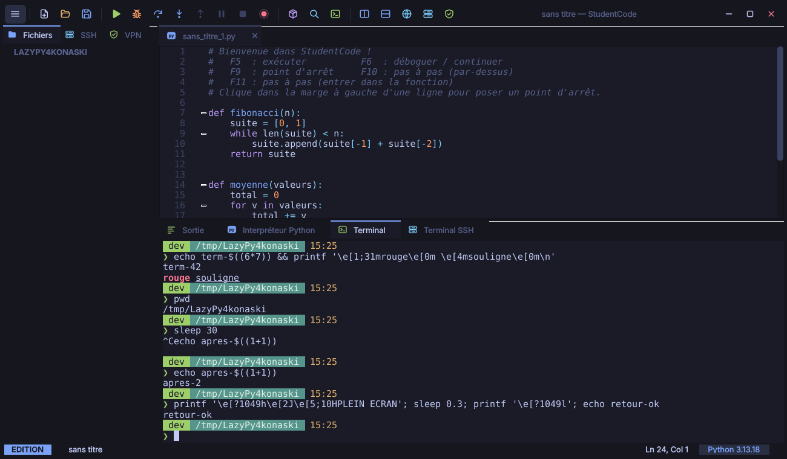

# StudentCode

Un espace de travail pour étudiant en informatique sur Ubuntu : un IDE Python façon
PyScripter, dans une interface à volets inspirée de VS Code et de LazyVim, où le code,
les pages de cours et les PDF tiennent dans la même fenêtre.



## Installation

Depuis une version publiée (page « Releases » du dépôt) :

```bash
tar xzf StudentCode-*.tar.gz && cd StudentCode-*/
./install.sh            # ou ./install.sh --no-libs pour une mise à jour rapide
~/.local/bin/studentcode
```

Ou depuis le dépôt : `git clone` puis `./install.sh` dans le dossier.

Prévu pour Ubuntu (24.04 et plus récent). Tout est installé dans `~/.local/share/studentcode`,
avec un environnement Python dédié ; rien n'est modifié dans le système, à part quelques paquets
apt demandés au premier lancement de l'installeur. Pour désinstaller :

```bash
rm -rf ~/.local/share/studentcode ~/.local/bin/studentcode ~/.local/share/applications/studentcode.desktop
```

## Volets

- **Scinder** : Alt+V (à droite), Alt+H (en bas), ou les boutons de la barre. Chaque volet a ses onglets.
- **Dans un onglet** : du code, une page web (Ctrl+T), un PDF, une image.
- **Ouvrir à côté** : clic droit sur un fichier de l'explorateur, ou sur un onglet pour le déplacer.
- **Naviguer** : Alt+W volet suivant, Alt+Maj+W déplacer l'onglet, Alt+Q fermer le volet.
- **Web** : barre d'adresse, favoris (étoile), session conservée entre deux lancements,
  PDF du site affichés dans l'onglet, téléchargements dans le dossier Téléchargements.
- F5 et le débogueur visent toujours le dernier fichier de code utilisé, même si le
  curseur est dans la page web.

## Aide par IA

- Bouton **IA** en haut à droite (Alt+I) : ouvre le panneau d'aide à droite de la fenêtre. Tout s'y passe :
  question, contexte du fichier, réponse.
- **Première fois** : « Ajouter une connexion IA », choisis le service, colle ta clé d'API,
  « Charger les modèles », « Enregistrer ». La clé est enregistrée (trousseau du système, sinon fichier
  privé `~/.config/StudentCode/ai_keys.json` lisible par toi seul) : tu ne la ressaisis pas.
- **Services** : Gemini et Mistral (offre gratuite limitée), ChatGPT/OpenAI et Claude (payants à l'usage),
  Ollama (modèle local, sans clé), ou tout service compatible OpenAI.
- **Contexte** : le fichier ouvert (ou ta sélection) est joint, et la sortie du programme pour une erreur.
  Il n'est renvoyé que s'il a changé depuis le dernier message.
- Actions rapides : expliquer, trouver l'erreur, relire, proposer des tests ; ou ta propre question.
- Le pré-prompt (consigne de tuteur) est modifiable.
- Le type « site web de l'assistant » existe encore dans Connexions IA pour qui n'a pas de clé, mais il
  n'est plus proposé par défaut.
- Une IA peut se tromper : vérifie en exécutant ton code.

## Terminal

- Onglet **Terminal** du panneau du bas (Alt+T) : ton shell, avec ton invite, tes couleurs et tes alias.
- Un vrai terminal : vim, nano, htop, complétion par Tab, Ctrl+C, historique (Maj+PagePréc.).
- Ctrl+Maj+C / Ctrl+Maj+V pour copier-coller ; le clic du milieu colle la sélection.
- L'onglet **Terminal SSH** est le même terminal, sur la machine du lab connecté.

## Thèmes et disposition

- ☰ → Affichage → Thème : Tokyo Night, Storm, Catppuccin, Everforest, Gruvbox, Nord, Dracula,
  Rosé Pine et trois thèmes clairs. L'application se relance et rouvre ta session.
- Glisse un onglet vers le bord droit, gauche ou bas d'un volet pour scinder de ce côté ;
  vers un autre volet pour l'y déplacer.

## VPN

- Onglet **VPN** du panneau de gauche : « Ajouter un VPN (.ovpn) », puis « Connecter ».
- Identifiant et mot de passe demandés une fois, gardés dans le trousseau du système.
- Passe par NetworkManager : le VPN ajouté apparaît aussi dans le menu réseau d'Ubuntu.
- **Internet conservé** : la case « Garder internet : VPN seulement pour le lab » (cochée par défaut) ne fait
  passer par le VPN que le réseau du lab ; le reste passe par ta connexion normale. La machine SSH à laquelle
  tu te connectes est ajoutée toute seule ; d'autres réseaux se saisissent dans le champ en dessous.
- Un lab SSH peut indiquer son VPN (« VPN à activer avant ») : il est monté tout seul à la connexion.

## Session

À la fermeture, StudentCode retient les volets, leurs tailles, les onglets ouverts (code, PDF,
images, pages web) et la position du curseur ; tout est rouvert à l'identique au lancement suivant.
Les fichiers ouverts depuis un lab SSH ne sont pas rouverts (il faut d'abord se reconnecter).

## SSH (labs, RemoteLabz…)

- **Connexion** : onglet SSH du panneau de gauche (ou Ctrl+Alt+S). Tape `ubuntu@adresse-ip` puis Entrée,
  saisis le mot de passe, c'est connecté. Les machines déjà utilisées restent dans la liste.
- **Options avancées** (menu « … ») : port, clé SSH, VPN à activer avant, machine relais, nettoyage.
  On peut aussi coller une commande `ssh -p 2222 user@machine` dans le champ.
- **Mot de passe** : gardé dans le trousseau du système (jamais en clair dans un fichier).
- **Explorateur distant** : ouvrir, créer, renommer, supprimer, envoyer et télécharger des fichiers.
- **Édition** : un fichier distant s'ouvre dans un onglet (marqué ⇄) ; Ctrl+S l'envoie sur la machine.
- **F5** exécute le fichier sur la machine (sortie et `input()` dans l'onglet Sortie).
- **Terminal SSH** dans le panneau du bas : un vrai terminal sur la machine (vim, nano, Tab).
- **Nettoyage à la connexion** (option du lab) : ferme tes anciennes sessions SSH et les programmes
  restés attachés à un terminal. À ne pas cocher sur un compte partagé.
- Une seule connexion par lab ; une coupure est détectée et signalée, rien n'est perdu.

## Complétion

Automatique pendant la frappe, y compris pour les classes et fonctions de tes autres fichiers
(`from Message import Message` puis `m.` propose ses méthodes). Ctrl+Espace la force, une
info-bulle montre les paramètres après `(`, F12 va à la définition.

## Côté Python (l'ancien LazyPy)

- **Éditeur** : coloration, pliage, indentation auto, complétion (jedi), rechercher/remplacer.
- **Exécution** (F5) ; après la fin du programme, l'interpréteur reste actif sur ses
  variables, fonctions et classes (ex. `Message([2, 3])`).
- **Débogueur pas à pas** : points d'arrêt (F9 ou clic dans la marge), continuer (F6),
  pas à pas (F10), entrer (F11), sortir (Maj+F11), variables dépliables, pile d'appels.
- **Bibliothèques** (Ctrl+Maj+L) : installation, mise à jour, désinstallation via pip.
- **Explorateur** : sélection multiple, glisser-déposer, renommer (F2), corbeille (Suppr).
- **Ctrl+P** recherche floue de fichiers · **F1** tous les raccourcis · mode Vim optionnel.

## Limites connues

- Le mode Vim couvre l'essentiel, pas tout Vim.
- Le débogueur suit le thread principal et ne s'arrête que dans ton code.
- Coloration syntaxique pour Python uniquement.
- Le débogueur pas à pas ne fonctionne que sur les fichiers locaux.

## Développement

- Le code est dans `studentcode/` (Python, PyQt6) ; `python3 studentcode/main.py` le lance sans installer,
  une fois les dépendances présentes (`PyQt6 PyQt6-QScintilla PyQt6-WebEngine jedi paramiko keyring pyte`).
- `./scripts/make-release.sh` construit l'archive d'une version dans `dist/`.
- Pour publier une version : changer `__version__` dans `studentcode/main.py`, compléter `CHANGELOG.md`,
  puis `./publier.sh` (ou pousser une étiquette `vX.Y.Z` : la publication se fait toute seule).
